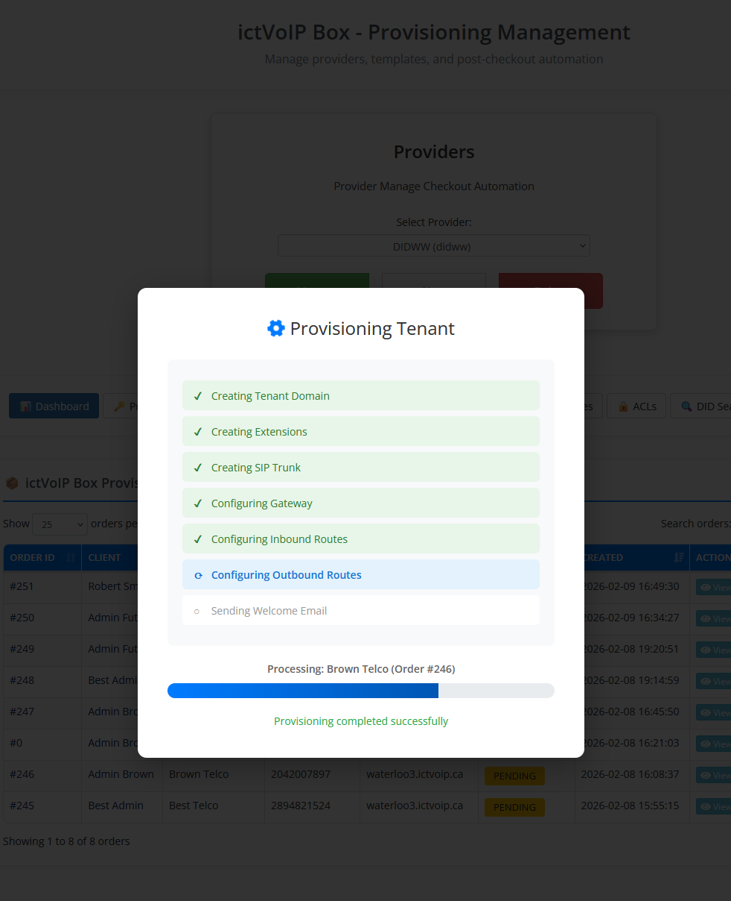
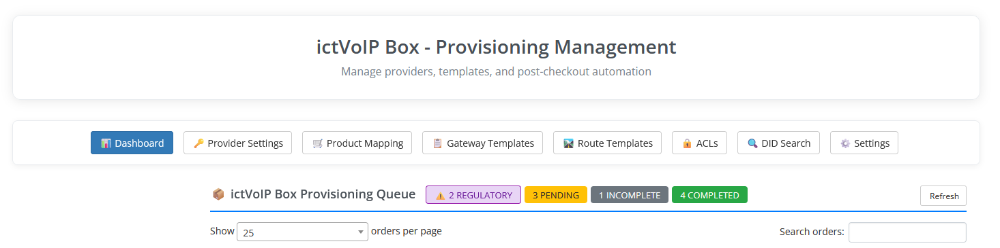

Provisioning Workflows
======================

.. contents::
   :local:
   :depth: 2

Provisioning (Standard)
-----------------------

**Timeline: Admin-initiated (typically 5-15 minutes)**

1. **Client Orders** Provider DID through shopping cart
2. **Order Created** in provisioning database
3. **Admin Queue** displays order with status ``Pending``
4. **Admin Reviews** order in provisioning queue
5. **Admin Clicks "Provision"** button
6. **System Executes**:

   * Creates/verifies FusionPBX tenant domain
   * Creates admin user with credentials
   * Provisions extensions
   * Configures Provider SIP gateway
   * Creates inbound route for DID
   * Creates outbound route
   * Sends welcome email with credentials

7. **Status Updated** to ``Completed``

**Admin Actions Required:**

* Review order details
* Click "Provision" button
* Verify provisioning success

**Gateway Configuration:**

* SIP username from Provider credentials
* SIP password from Provider credentials
* Proxy: ``{location}.provider1.example`` (e.g., ``toronto.provider1.example``)
* Port: 5060 (UDP) or 5061 (TLS)

|

|

Admin Queue Management
======================

.. contents::
   :local:
   :depth: 2

Provisioning Queue Interface
-----------------------------

Navigate to **Addons → ictVoIP Box → Provisioning Queue**

The provisioning queue displays all pending, in-progress, and completed orders. Administrators can review order details, manage provisioning workflows, and monitor status.

**Queue Columns:**

* **Order ID**: WHMCS order identifier
* **Client**: Client name and contact information
* **Product**: Product/bundle ordered
* **Provider**: VoIP.ms or DIDWW
* **DID**: Selected phone number
* **Status**: Current provisioning status with badge
* **Actions**: Available admin actions based on status

**Status Badges:**

* **Pending** (blue): Awaiting admin review
* **In Progress** (yellow): Provisioning in progress
* **Completed** (green): Fully provisioned
* **Failed** (red): Provisioning error

|

|
